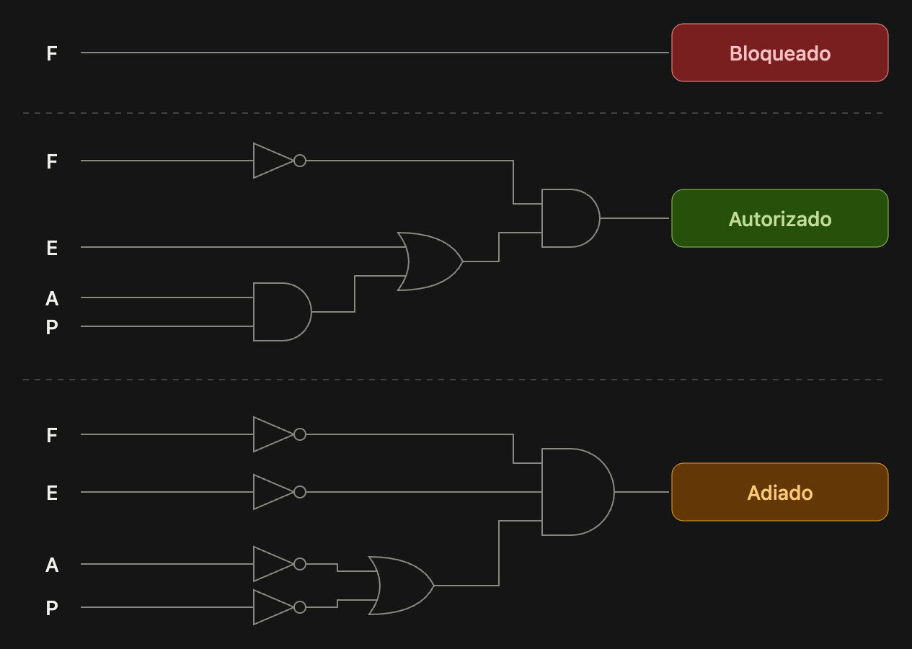
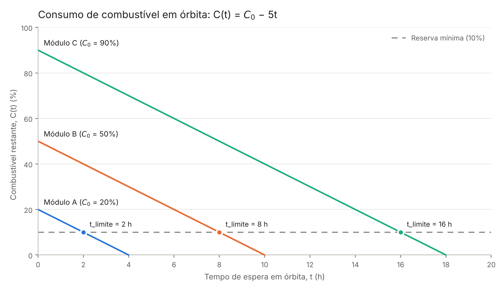

Atividade Integradora - Modulo de Gerenciamento de Pouso e Estabilizacao de base 

1. Modelar o cenário de pouso e filas dos módulos

Considerando que a sociedade atual necessita de:

Saude
Segurança 
Energia 
Infraestrutura Tecnologica (Comunicacao)
Alimentacao e Agua (Suprimentos)
Mobilidade (Transporte)

Os modulos definidos foram:

Modulo de Saude 
Modulo de Seguranca
Modulo de Energia
Modulo de Comunicacao
Modulo de Suprimentos
Modulo de Transporte

Modulos e suas respectivas estruturas de dados:

Modulo de Suprimentos, Energia -> Já pousaram -> Lista
Modulos de Comunicacao e Saude -> Aguardando autorizacao de pouso -> Fila
Modulo de Transporte -> Em espera -> Lista
Modulo de Seguranca -> Em alerta -> Lista

Os valores de todos os atributos de cada módulo seguirão essa faixa:

Prioridade de pouso: 1 a 5 (1 = mais urgente)
Nível de combustível: 10% a 100%
Massa: 10 a 20 toneladas
Criticidade da carga: Baixa, Média ou Alta
Horário estimado de chegada à órbita: 06:00 a 18:00

 2. Definir e representar regras de decisão usando portas lógicas

 As condições para autorização de pouso seguirão esses estados:

Combustível: 10% a 100% (seguro se for maior ou igual a 20%)
Condições atmosféricas: Estável, Tempestade de poeira, Ventos fortes (seguro se Estável)
Área de pouso: Livre, Ocupada, Obstruída (seguro se Livre)
Sensores: Operacional, Falha parcial, Falha total (seguro se Operacional)

Aqui está o item 2 completo, já com a lógica nova:

---

**2. Definir e representar regras de decisão usando portas lógicas**

O MGPEB funciona como a torre de controle de um aeroporto: os módulos chegam à órbita de Marte e aguardam na fila, e o sistema decide, para cada um, se o pouso será **autorizado**, **adiado** ou **bloqueado**.

**Condições avaliadas:**

| Condição | Estados possíveis | Variável booleana |
|---|---|---|
| Integridade dos sensores | Operacional, Falha parcial, Falha total | F = 1 se Falha total |
| Combustível | 10% a 100% | E = 1 se combustível < 10% (emergência) |
| Condições atmosféricas | Estável, Tempestade, Ventos fortes | A = 1 se Estável |
| Área de pouso | Livre, Ocupada, Obstruída | P = 1 se Livre |

**Lógica de decisão (comparação com a aviação):**

As regras são verificadas em ordem de gravidade, da condição mais crítica para a menos crítica.

1. **Falha total dos sensores → Bloqueado.** Sem sensores, o módulo não sabe a própria altitude e velocidade, e uma descida às cegas pode destruir a nave e atingir a base. Como um avião sem instrumentos de navegação, ele é mantido afastado até que possa ser guiado de fora (radar da base ou sensores reservas). Permanecer em órbita quase não consome combustível, então o bloqueio não condena a nave.

2. **Combustível baixo → Autorizado (emergência).** Na aviação, uma aeronave com pouco combustível declara emergência e ganha prioridade de pouso, mesmo com tempo ruim, porque esperar significa perda certa, enquanto pousar em condições ruins é apenas um risco. O MGPEB segue o mesmo princípio: o módulo pula a fila e pousa mesmo com atmosfera instável. Se a área estiver ocupada, ele é desviado para uma área alternativa.

3. **Atmosfera instável ou área indisponível → Adiado.** O módulo está em boas condições, mas o ambiente não está. Assim como um avião entra em circuito de espera quando a pista está ocupada ou há tempestade, o módulo aguarda em órbita até as condições melhorarem.

4. **Demais casos → Autorizado.** Inclui módulos com falha parcial dos sensores, que ainda conseguem realizar a descida com segurança.

**Expressões booleanas:**

- **Bloqueado** = F
- **Autorizado** = NOT F AND (E OR (A AND P))
- **Adiado** = NOT F AND NOT E AND (NOT A OR NOT P)

**Destino de cada módulo:**

| Decisão | Estrutura de dados |
|---|---|
| Autorizado | Lista de módulos pousados |
| Adiado | Lista de módulos em espera |
| Bloqueado | Lista de módulos em alerta |

---

E o diagrama de portas lógicas das três expressões:

O diagrama pode ser baixado e colado direto no relatório. Na leitura: os triângulos com bolinha são portas NOT, as formas em "D" são AND e as formas curvas são OR. Cada saída colorida corresponde a uma das três expressões.

Um ponto para ajustar antes do código: no seu pseudocódigo, 10% entra tanto em `C <= 10%` quanto em `C >= 10%`, então use `combustivel < 10` para a emergência. E como a faixa sorteada começa em 10%, a emergência nunca vai acontecer na simulação. Vale mudar a faixa para 0% a 100%, ou subir o limite (por exemplo, para 25%). Se mudar, atualize o valor na tabela de condições também.

3. Implementar, em Python, um protótipo do MGPEB

Feito! Na pasta

4. Modelagem matemática aplicada ao pouso

O fenômeno escolhido foi o consumo de combustível dos módulos durante a espera em órbita. Enquanto aguarda a autorização de pouso, cada módulo permanece em órbita realizando pequenas correções de trajetória e de orientação, o que consome combustível continuamente. Considerando que essas correções ocorrem em ritmo constante, o consumo foi representado por uma função linear:

C(t) = C₀ − k·t

Parâmetro	Significado	Unidade
C(t)	Combustível restante após t horas de espera	%
C₀	Combustível no momento da chegada à órbita	%
k	Taxa de consumo (inclinação da reta)	%/hora
t	Tempo de espera em órbita	horas

Para realizar o pouso com segurança, o módulo precisa manter uma reserva mínima de combustível (C_min = 10%), destinada à queima dos retrofoguetes durante a descida. Igualando C(t) a C_min, obtém-se o tempo máximo que cada módulo pode permanecer em espera:

t_limite = (C₀ − C_min) / k

Adotando uma taxa de consumo k = 5 %/h, três módulos com diferentes níveis iniciais de combustível apresentam os seguintes tempos limite:

Módulo	C₀	t_limite
A	20%	2 h
B	50%	8 h
C	90%	16 h

Figura 1 – Consumo de combustível em órbita para três módulos 

Análise qualitativa do gráfico

A função é representada por uma reta decrescente, com inclinação igual a −k, já que o combustível diminui à medida que o tempo de espera aumenta. O valor de C₀ define o ponto de partida da reta: quanto maior o combustível inicial, mais alta ela começa e mais tempo o módulo leva para atingir a reserva mínima. Já a taxa k define a inclinação: quanto maior o consumo, mais inclinada é a reta e mais rapidamente o combustível se esgota. Módulos mais pesados tendem a apresentar valores maiores de k, pois exigem mais impulso a cada correção. O ponto em que cada reta cruza a linha horizontal da reserva mínima corresponde ao seu t_limite, a partir do qual o módulo não possui mais combustível suficiente para pousar com segurança.

Relação com as decisões do MGPEB

A principal aplicação do modelo está na definição da prioridade de pouso. Em vez de ser atribuída arbitrariamente, a prioridade passa a ser calculada a partir do t_limite: quanto menor o tempo de espera disponível, mais urgente é o pouso. Dessa forma, a ordem da fila deixa de depender apenas do tipo de módulo e passa a refletir o risco real de cada um.

t_limite	Prioridade
até 2 h	1
2 a 4 h	2
4 a 8 h	3
8 a 12 h	4
acima de 12 h	5

O modelo também orienta outras decisões do sistema. A reserva mínima garante que haverá combustível para acionar os retrofoguetes no momento da descida, de modo que nenhum módulo deve permanecer em espera além do seu t_limite. Quando um pouso é adiado por condições atmosféricas desfavoráveis ou pela indisponibilidade da área, o sistema conhece exatamente quanto tempo aquele módulo ainda pode aguardar e, caso esse tempo esteja se esgotando, o pouso passa a ser tratado como emergência. Por fim, ao identificar vários módulos com tempos limite próximos, o MGPEB pode antecipar o risco de pousos simultâneos, liberando primeiro o mais urgente ou direcionando algum deles para uma área de pouso alternativa.

